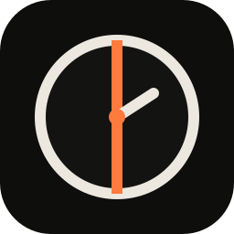
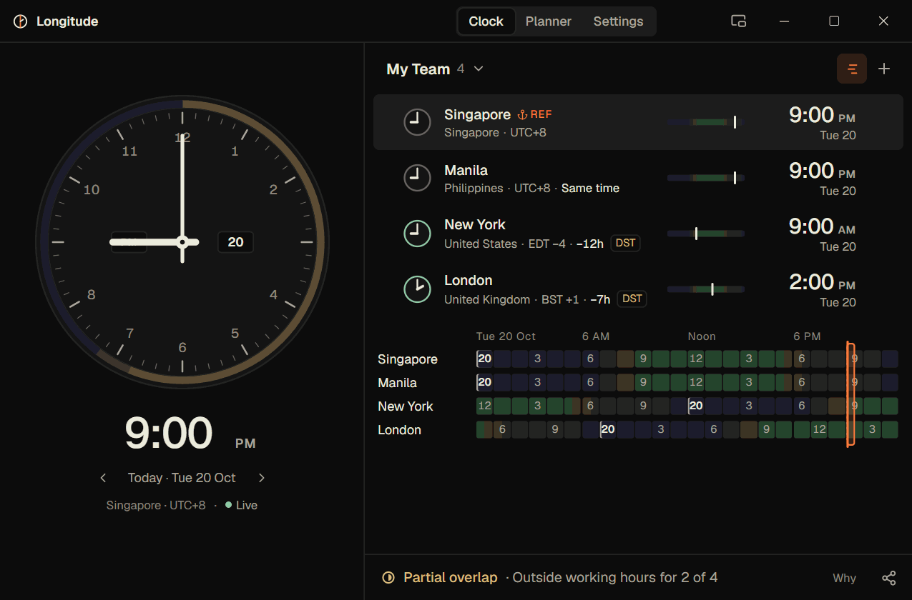

<div align="center">



# Longitude

**A desktop clock for working with teammates and clients across time zones.**

Drag the clock to any time and see every city follow: their local time, their date, who's working and who's asleep.

[](https://github.com/jrulloda14/Longitude/releases/latest)


[](LICENSE)



</div>

## What it does

- **See everyone's time at once.** Add the cities your teammates and clients work in. Each row shows their local time, date, offset and whether it's today, tomorrow or yesterday for them.
- **Drag the clock to plan.** Turn the hands, scroll or use the arrow keys, and every city updates instantly, even across midnight and daylight-saving changes.
- **Know who's available.** Working hours, early/late edges and sleeping hours are shaded for every person, on the rows and on a 24-hour timeline.
- **Find a meeting time.** The planner suggests times that fall inside everyone's working hours and explains why.
- **Send the right time to everyone.** Copy a summary with each person's local time, or export an `.ics` file for any calendar.
- **Catch clock changes.** Daylight-saving notices warn you when a city's offset is about to change or differs on the date you picked.
- **Keep it handy.** A compact always-on-top widget, a tray/menu-bar icon and a global shortcut (<kbd>Ctrl</kbd>+<kbd>Alt</kbd>+<kbd>T</kbd> on Windows, <kbd>⌥</kbd><kbd>⌘</kbd><kbd>T</kbd> on Mac).

**Private by design:** no account, no sign-up, no telemetry and no internet connection needed. Everything stays on your computer.

## Download

Get the latest version from the **[Releases page](https://github.com/jrulloda14/Longitude/releases/latest)**.

| Platform | File | Notes |
| --- | --- | --- |
| Windows 10 / 11 (64-bit) | `Longitude_<version>_x64-setup.exe` | Installs for your user account; no admin rights needed |
| macOS 12+ (Apple Silicon and Intel) | `Longitude_<version>_universal.dmg` | **Preview**: not yet signed by Apple or tested on Mac hardware |

Longitude isn't code-signed yet, so Windows and macOS will show a warning the first time you open it. The **[installation guide](docs/INSTALL.md)** walks through it step by step.

## Using Longitude

1. **Add your people.** Click **+** (or <kbd>Ctrl</kbd>+<kbd>K</kbd>) and search for a city, country, time zone or abbreviation such as `EST` or `+5:30`.
2. **Pick your reference.** The ⚓ **REF** city is the one the big clock shows. Right-click a row (or use its ⋯ menu) and choose **Set as reference**. **Working hours…** sets that person's hours and an optional label such as "Client A".
3. **Plan a time.** Drag the clock hands or the orange marker on the timeline. Double-click the dial or press <kbd>Home</kbd> to jump back to now.
4. **Share it.** Click the share icon (<kbd>Ctrl</kbd>+<kbd>Shift</kbd>+<kbd>C</kbd>) to copy the time for everyone or export a calendar file.

The **[user guide](docs/USER_GUIDE.md)** covers the planner, widget, groups, settings and every keyboard shortcut.

## Build from source

Requires Node.js 24, npm 11 and stable Rust, plus the [Tauri 2 prerequisites](https://v2.tauri.app/start/prerequisites/) for your platform.

```bash
npm ci
npm run desktop:dev      # run the desktop app in development
npm run desktop:build    # build the installer / app bundle
npm test                 # unit tests
```

See [CONTRIBUTING.md](CONTRIBUTING.md) for the full test suite and project conventions, and [docs/BUILD_AND_RELEASE.md](docs/BUILD_AND_RELEASE.md) for packaging details.

## Project status

Longitude is an early preview (v0.x). Windows is the primary tested platform. The macOS build compiles and passes automated tests in CI but hasn't yet been checked on real Mac hardware. Known issues and engineering records live in the [project status page](docs/PROJECT_STATUS.md) and the [changelog](CHANGELOG.md).

Built with [Tauri 2](https://tauri.app), React, TypeScript and Rust. Time zone data comes from your operating system's IANA database.

## License

[MIT](LICENSE) © 2026 Longitude contributors. Third-party notices ship with the app.
