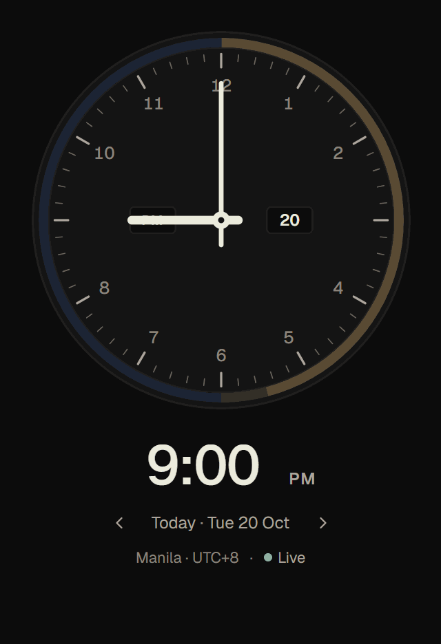

# Longitude user guide

Longitude shows the time for everyone you work with and lets you plan by moving one clock. This guide covers each part of the app. New here? The [README](../README.md#using-longitude) has a four-step quick start.

## The clock

The big dial shows the time in your **reference city** (marked ⚓ **REF**).

- **Live:** while the green **Live** dot shows, the clock follows the current time.
- **Planning:** move the clock and it switches to the time you picked. The minute hand turns orange, faint dotted hands keep showing the real time, and the readout says how far ahead or behind you are ("in 3h", "2h ago").
- **Date window:** the box at 3 o'clock shows the day of the month. It turns orange when your picked time falls on a different day than today.
- **AM/PM window:** at 9 o'clock.
- **Sky ring:** the outer ring shows day, twilight and night for the reference city across the half-day on the dial.

**Ways to set the time:**

| Action | Result |
| --- | --- |
| Drag the minute hand | One full turn = 1 hour; keeps going past 12 and midnight |
| Drag the hour hand | One full turn = 12 hours |
| Mouse wheel | ± one step per notch (<kbd>Shift</kbd> = 1 min, <kbd>Alt</kbd> = 1 hour) |
| <kbd>←</kbd> <kbd>→</kbd> <kbd>↑</kbd> <kbd>↓</kbd> | ± one step (5 min by default; <kbd>Shift</kbd> = 1 min) |
| <kbd>Page Up</kbd> / <kbd>Page Down</kbd> | ± 1 hour |
| <kbd>]</kbd> / <kbd>[</kbd> | ± 1 day |
| Double-click, <kbd>Home</kbd> or <kbd>N</kbd> | Back to now |
| Type in the big time readout | `14:30`, `2:30p`, `930`, `noon`, `midnight`; <kbd>Enter</kbd> to apply, <kbd>Esc</kbd> to cancel |

If a typed time doesn't exist (skipped by a daylight-saving jump) or happens twice (clocks fall back), Longitude tells you and lets you pick the right one.

## Locations and groups

Each row shows a city's local time and date, its offset, the difference from your reference, and a small strip of that person's day. A **+1 day** or **−1 day** tag appears when they're on a different date. A **DST** tag means their clock changes within the next three weeks; hover it for details.

- **Add:** click **+** or press <kbd>Ctrl</kbd>+<kbd>K</kbd>. Search by city, country, time zone (`Asia/Manila`), abbreviation (`EST`, `BST`) or offset (`+5:30`, `utc-3`).
- **Row menu:** right-click a row, or use its ⋯ button:
  - **Set as reference:** the big clock follows this city.
  - **Working hours…:** working days and hours (overnight shifts are fine), sleeping hours, and an optional **label** such as "Client A" or "Design team".
  - **Add to / Remove from favorites:** favorites appear in the compact widget.
  - **Copy local time**, **Move up / down** (<kbd>Alt</kbd>+<kbd>↑</kbd>/<kbd>↓</kbd>), **Remove** (<kbd>Del</kbd>).
- **Reorder:** drag rows by their handle.
- **Groups:** keep separate lists, such as "My Team" or "Client B", with the group menu above the rows. Switch with <kbd>Ctrl</kbd>+<kbd>1</kbd>…<kbd>9</kbd>.

**Colours:** green is working hours, sand is the hour before or after work, slate is sleeping hours. A small glyph and word always go with the colour.

## Timeline

The 24-hour strip under the rows shows every person's day side by side, aligned to your reference city's date. Drag the orange marker, or use the arrow keys, to move the selected time. The outlined areas are when everyone is working, and the dotted line is the current time. Turn the timeline on or off with the timeline button or in **Settings**.

## Planner

Open **Planner** at the top of the window to schedule a meeting.

- **Overlap verdict:** set the **duration** and Longitude rates the time as **Good overlap** (everyone working), **Partial overlap**, or **Poor overlap** (someone asleep, or fewer than half working). Expand it to see who's affected.
- **Suggested:** up to three times that best fit everyone's working hours. Click one to select it, or **Why these times** to see the reasoning.
- **Search options:** look across a date range, choose which people must be included, set minimum shared working time, or balance inconvenience fairly between people.

Suggestions use working hours only. They don't know about anyone's calendar, so they never claim someone is free.

## Sharing a meeting time

Click the share icon or press <kbd>Ctrl</kbd>+<kbd>Shift</kbd>+<kbd>C</kbd>. Give the meeting a title and duration, then choose a format:

| Format | Best for |
| --- | --- |
| **Full** | Email: every person's local date and time, zone and working-hours status |
| **One line** | Chat messages |
| **Local times** | A quick list of each person's time |
| **UTC** | Technical audiences |

What you see in the preview is exactly what's copied. **Export** saves an `.ics` calendar file you can import into Outlook, Google Calendar or Apple Calendar.

**Weekly** repeats the meeting. Choose whether it stays at a fixed UTC time or follows your reference city's local time; Longitude warns you if anyone's local time shifts because of daylight saving.

## Compact widget, tray and shortcut

- **Widget:** a small always-on-top clock with up to five favorite locations.
  - **Open it:** with <kbd>Ctrl</kbd>+<kbd>Shift</kbd>+<kbd>M</kbd>, the widget button in the title bar, or the global shortcut.
  - **Preview a time:** scroll over it to look ahead in 15-minute steps; it returns to now after a few seconds.
  - **Adjust it:** pin or unpin it from the top of other windows and change its opacity.
- **Tray / menu bar icon:** on Windows, click the tray icon to show or hide the widget and right-click for the menu; on a Mac, click the menu bar icon for the menu. The menu offers **Open Longitude**, **Show / hide widget**, **Back to now**, **Settings**, **Groups** and **Quit Longitude**.
- **Global shortcut:** <kbd>Ctrl</kbd>+<kbd>Alt</kbd>+<kbd>T</kbd> on Windows or <kbd>⌥</kbd><kbd>⌘</kbd><kbd>T</kbd> on Mac toggles the widget from anywhere. You can change it in Settings; if another app already uses your choice, Longitude keeps the previous shortcut and tells you.

## Settings

Open **Settings** (<kbd>Ctrl</kbd>+<kbd>,</kbd>) to change:
- the clock format (12/24 h) and dial precision (1 or 5 minutes);
- default working hours and days for new locations;
- the theme (System, Dark or Light), reduced motion, and whether the timeline shows on the Clock view;
- the widget, tray icon, global shortcut, what closing the window does, and **Launch at sign-in**.

## Keyboard shortcuts

On a Mac, use <kbd>⌘</kbd> in place of <kbd>Ctrl</kbd>.

| Shortcut | Action |
| --- | --- |
| <kbd>Ctrl</kbd>+<kbd>K</kbd> | Add a location |
| <kbd>Ctrl</kbd>+<kbd>Shift</kbd>+<kbd>C</kbd> | Share this time |
| <kbd>Ctrl</kbd>+<kbd>Shift</kbd>+<kbd>M</kbd> | Toggle the compact widget |
| <kbd>Ctrl</kbd>+<kbd>,</kbd> | Settings |
| <kbd>Ctrl</kbd>+<kbd>1</kbd>…<kbd>9</kbd> | Switch group |
| <kbd>Home</kbd> | Back to now |
| <kbd>Ctrl</kbd>+<kbd>Alt</kbd>+<kbd>T</kbd> / <kbd>⌥</kbd><kbd>⌘</kbd><kbd>T</kbd> | Show or hide the widget from anywhere |

## Your data

Everything stays on your computer. Longitude has no account, no telemetry and never connects to the internet. Settings are saved in your user profile; see [Installing](INSTALL.md) for the exact folder. Time zone and daylight-saving rules come from your operating system and update with it.
